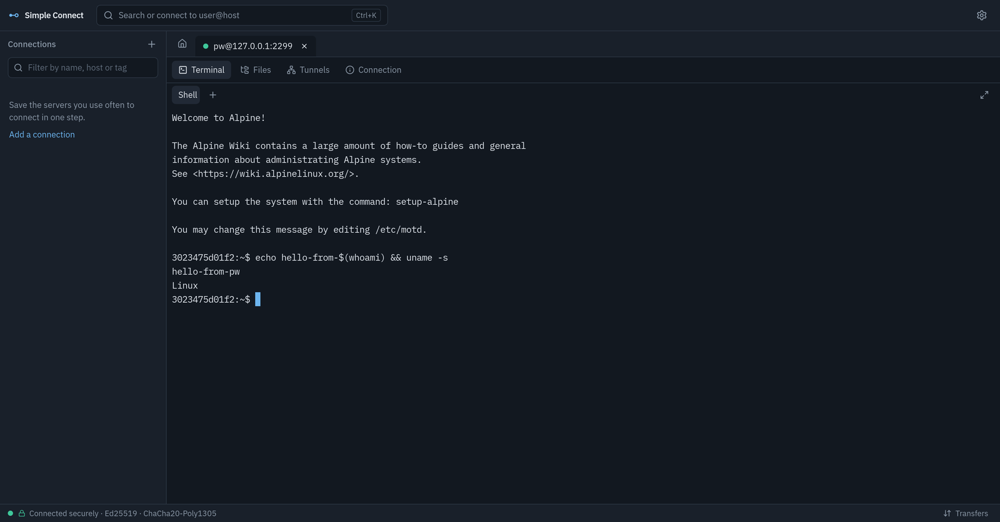
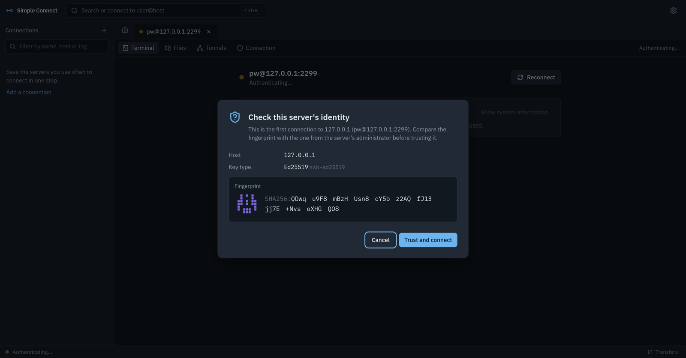
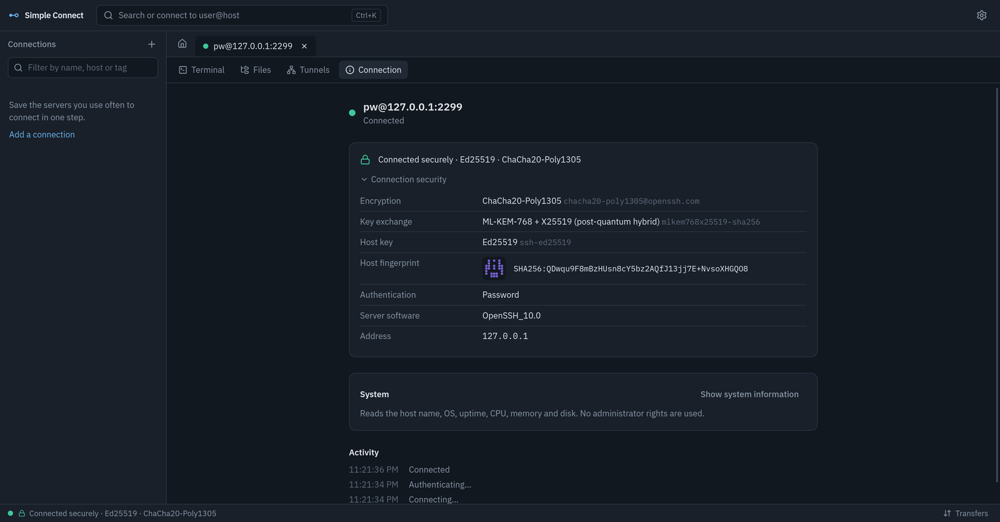
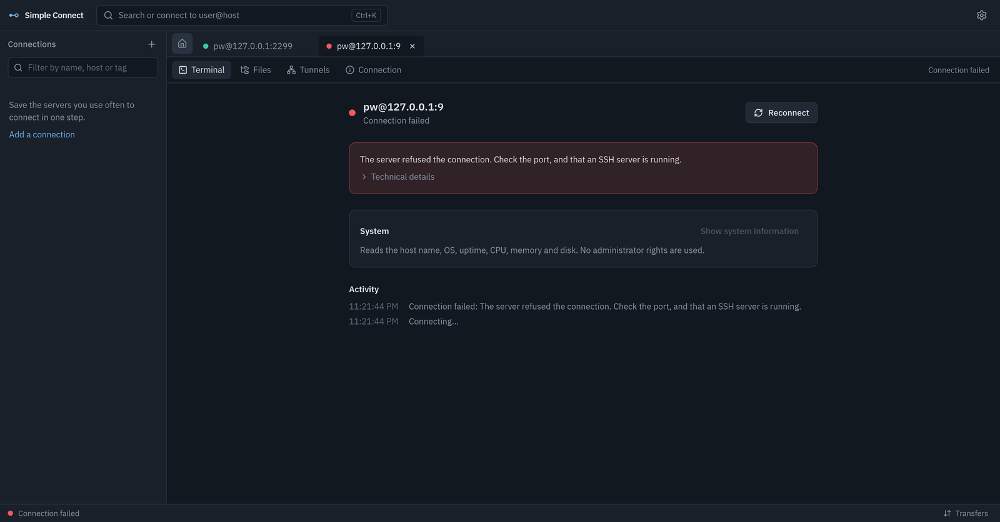

# Simple Connect

A secure SSH terminal, SFTP and remote desktop client for Linux, Windows and macOS. It is built on your system's
OpenSSH, with a modern interface and secure defaults.

* **Terminal.** Full xterm.js terminal with tabs, multiple shells per connection,
  search, themes, font settings, full screen and a confirmation for multi-line pastes.
  Output stays smooth under floods thanks to flow control.
* **Files.** Two-pane SFTP browser over the *same* connection: drag and drop, folders,
  rename, copy, delete, permissions, a hidden-files toggle and filtering. Transfers are
  streamed, pipelined, resumable, pausable and verified with SHA-256. A built-in editor
  with syntax highlighting saves atomically.
* **Find devices.** Scan your local network for computers, servers and boards with SSH
  (name, IP, MAC, SSH version), then connect or save them in one click. Saved devices
  are recognised by MAC address even when their IP changes.
* **Connections.** Friendly names everywhere instead of IP addresses, folders,
  favorites, tags (`#tag` filtering), colors, search, quick connect (`user@host`,
  `ssh -p 2222 user@host`, `ssh://…`), your `~/.ssh/config` aliases, and jump hosts with
  a visual route.
* **sudo without retyping.** When `sudo` asks for your password, press Enter to send
  the password you signed in with. It is never shown, and never sent without your keypress.
* **Remote desktop.** See and control the desktop of Linux (X11, Wayland, headless),
  Windows and macOS computers over the same SSH connection: share the screen, open a
  virtual desktop that survives disconnects, or use Remote Desktop (RDP) and Screen
  Sharing. Fit or resize, full screen, clipboard, special keys, drop files to upload,
  and guided setup when nothing is installed. Nothing is exposed to the network. See
  [REMOTE_DESKTOP.md](REMOTE_DESKTOP.md).
* **Tunnels.** Local, remote and SOCKS forwarding, restored after reconnects.
* **Keys.** Generate Ed25519 / ECDSA / RSA or FIDO2 security-key SSH keys, import keys,
  copy or export public keys, and change passphrases.
* **Security first.** Host-key verification that can't be turned off, a prominent
  warning when a server's key changes, modern algorithms only, passwords in your system
  keyring or an Argon2id + XChaCha20-Poly1305 vault, app lock, clipboard auto-clear,
  redacted logs, and no telemetry or accounts.

| Trust a new server | Inspect a session | Errors you can act on |
|---|---|---|
|  |  |  |

## How it works

Every connection is made by the system `ssh` (OpenSSH 8.5+). Simple Connect writes a
strict per-connection configuration, answers OpenSSH's prompts through a local
authenticated helper, and multiplexes the terminal, SFTP and tunnels over one
ControlMaster connection. It implements no cryptography of its own. See
[SSH_SECURITY.md](SSH_SECURITY.md).

## Install

Download the Windows installer, macOS DMG, Linux `.deb`, `.rpm` or AppImage from
[GitHub Releases](https://github.com/fleetwoodjohnr/simple-connect/releases), or build it yourself
([BUILDING.md](BUILDING.md)). Windows installers include OpenSSH. On Linux you need the OpenSSH client (`openssh-clients` on Fedora,
`openssh-client` on Debian/Ubuntu).

Updates are checked at startup and daily. Settings → About lets you check manually,
disable automatic checks, or install a signed update after closing active work. macOS
builds use ad-hoc signatures and Windows builds may show unknown-publisher prompts;
see the release notes for installation instructions.

Works on GNOME, KDE Plasma, Cinnamon, XFCE, Hyprland and other desktops, on Wayland
and X11. Saved passwords use any Secret Service keyring (GNOME Keyring, KWallet); where
none exists, use the encrypted vault.

## Shortcuts

| | |
|---|---|
| `Ctrl+K` | Quick connect and command palette (`Ctrl+Shift+K` in a terminal) |
| `Ctrl+Shift+N` | New connection |
| `Ctrl+Shift+T` | New terminal in the current connection |
| `Ctrl+W` | Close tab (`Ctrl+Shift+W` in a terminal) |
| `Ctrl+Shift+F` | Search connections (find text when in a terminal) |
| `Ctrl+Shift+C` / `Ctrl+Shift+V` | Copy / paste in a terminal |
| `Ctrl+,` | Settings |
| `Ctrl+L` | Lock (`Ctrl+Shift+L` in a terminal) |

## Documentation

* [ARCHITECTURE.md](ARCHITECTURE.md): how the pieces fit together
* [THREAT_MODEL.md](THREAT_MODEL.md): threats, mitigations and residual risks
* [SECURITY.md](SECURITY.md): what is stored where, defaults, and reporting vulnerabilities
* [SSH_SECURITY.md](SSH_SECURITY.md): algorithm policy, host keys and authentication
* [REMOTE_DESKTOP.md](REMOTE_DESKTOP.md): remote desktop setup, security and limitations
* [DEVELOPMENT.md](DEVELOPMENT.md): setup, layout and tests
* [BUILDING.md](BUILDING.md): packaging and signed updates

## License

MIT OR Apache-2.0. The VNC viewer bundles [noVNC](https://github.com/novnc/noVNC)
(MPL-2.0); RDP uses [IronRDP](https://github.com/Devolutions/IronRDP) (MIT OR Apache-2.0).
