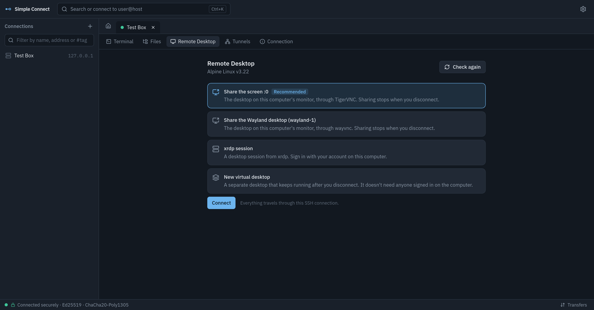
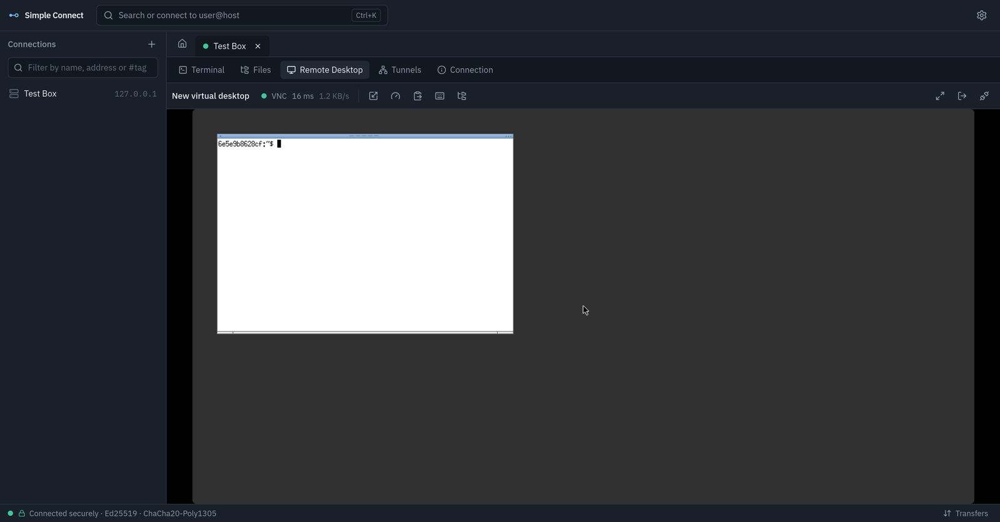

# Remote desktop

Open a connection, choose **Remote Desktop**, and Simple Connect shows the computer's
graphical desktop: you can see it and use the mouse, keyboard and clipboard. It
works next to the terminal and file browser of the same connection. Switching views
doesn't disconnect anything.

| Choosing how to connect | A virtual desktop |
|---|---|
|  |  |

Everything travels through that connection's SSH session. Simple Connect never opens
a port on your computer, never connects to a remote desktop service directly, and
never makes a desktop server listen on the network.

## How a desktop is reached

When you open the view, Simple Connect checks the computer and offers what it found:

| On the remote computer | Shown as | How |
|---|---|---|
| A Linux desktop on X11 (most Xorg sessions, NVIDIA Jetson) | **Share the screen :0** | TigerVNC's `x0vncserver` is started for you, on a private socket, and stopped when you disconnect |
| A wlroots Wayland desktop (Sway, labwc, Wayfire, Raspberry Pi OS) | **Share the Wayland desktop** | `wayvnc` is started the same way |
| Any Linux, with or without a monitor | **New virtual desktop** / **Your virtual desktop** | A separate desktop (TigerVNC `Xvnc` plus XFCE, MATE, LXQt…) that keeps running after you disconnect, until you sign out of it |
| GNOME Desktop Sharing, KDE Remote Desktop, xrdp | **GNOME Remote Desktop**, **xrdp session**, … | RDP to the computer's own loopback |
| Windows Pro, Enterprise or Server | **Windows Remote Desktop** | RDP to the computer's own loopback |
| macOS | **macOS Screen Sharing** | VNC with your Mac account |
| A VNC server on ports 5900–5903 | **VNC server on port …** | VNC to the computer's own loopback |

The recommended choice is preselected: the screen in use, then an existing server,
then a virtual desktop. A connection can remember a preferred method and the user
name to sign in with (**Edit connection › Remote desktop**).

If nothing suitable is installed, **Set up…** shows the exact commands that would run.
**Run in a new terminal** runs them where you can watch, and `sudo` asks for your
password as usual. Afterwards, choose **Check again**. Nothing is installed or changed
without that confirmation.

## Setting up each kind of computer

The remote computer needs an SSH server that Simple Connect can sign in to, with
forwarding allowed: the default `AllowTcpForwarding yes` and
`AllowStreamLocalForwarding yes`.

### Linux: Fedora, Ubuntu, Debian, Jetson

- **Share the screen (X11).** Install TigerVNC:
  - Fedora: `tigervnc-server`.
  - Debian, Ubuntu and Jetson: `tigervnc-scraping-server`.
  - **Set up…** does this.
  - You must be signed in on the computer's screen as the same user you connect with. A login screen can't be shared.
- **Virtual desktop.** Needs TigerVNC's `Xvnc` plus a desktop that runs under X11:
  - Packages: `tigervnc-server` on Fedora, `tigervnc-standalone-server` on Debian/Ubuntu.
  - **Set up…** also installs XFCE if no X11 desktop is installed.
  - It turns on lingering (`loginctl enable-linger`) so the desktop keeps running while you're not signed in.
  - This is the way to use a headless server or a Jetson without a monitor.
  - GNOME 49 and later can't run on X11. Use XFCE, MATE or LXQt for virtual desktops.
- **GNOME on Wayland** (the Fedora and Ubuntu default).
  - X11 screen sharing tools can't see a GNOME Wayland screen.
  - On the computer, open **Settings › System › Remote Desktop** and turn on **Desktop Sharing** and **Remote Control**, with a user name and password.
  - Simple Connect then offers **GNOME Remote Desktop**.
  - You don't need to open port 3389 in the firewall. GNOME listens on all interfaces, so keep the firewall closed (Fedora's default) or block 3389 with `sudo ufw deny 3389` on Ubuntu.
- **KDE Plasma on Wayland.** On the computer, open **System Settings › Remote Desktop** and turn it on. Plasma may ask on screen for permission to share it.
- **wlroots desktops.** Install `wayvnc` (**Set up…** does this).

### Windows

- Turn on the **OpenSSH Server** optional feature (**Settings › System › Optional features**).
- **Set up…** offers to turn on Remote Desktop with `reg add … fDenyTSConnections 0`, run from an administrator account.
- The firewall stays closed: Remote Desktop is used through SSH only.
- Network Level Authentication stays on.
- Sign in with your Windows account. Use `DOMAIN\name` for domain accounts, set under **Edit connection › Remote desktop › Sign in as**.
- Windows Home can't accept Remote Desktop. Install a VNC server (TightVNC, TigerVNC), set it to accept connections from localhost only, and choose **Check again**.

### macOS

- Turn on **Remote Login** (SSH) and **Screen Sharing** in **System Settings › General › Sharing**.
- macOS doesn't allow turning on Screen Sharing over SSH.
- Sign in with your Mac user name and password.

## Using it

- **Toolbar.**
  - The connection's health: protocol, latency (green is under 40 ms, amber under 120 ms) and data rate.
  - **Scaling:** fit to the window, actual size, or resize the remote desktop to the window (virtual desktops and RDP).
  - **Image quality:** automatic (chosen from the latency), high, balanced or low bandwidth.
  - **Clipboard**, **Send keys**, **Files**, **Full screen**, **Sign out** (virtual desktops) and **Disconnect**.
- **Keyboard.** Keys go to the remote computer while the desktop has focus.
  - Your own system may keep some shortcuts (Alt+Tab, the Super key, Ctrl+Alt+Del). Use **Send keys** for those.
  - `Ctrl+Alt+Enter` toggles full screen. In full screen, the toolbar appears when you move the pointer to the top edge.
- **Clipboard.** Text only, up to 1 MB. By default it moves only when you ask: **Send my clipboard** or **Copy the remote clipboard**. **Share the clipboard automatically** (toolbar or Settings) copies the remote clipboard as it changes, and sends yours when you click into the desktop.
- **Files.** Drop files on the desktop to upload them to `~/Desktop` on the remote computer; the folder is changeable in **Settings › Remote desktop**. **Files** opens the full file browser of the same connection. Transfers show in the transfer drawer and are verified as usual.
- **Reconnecting.**
  - If the SSH connection drops, the desktop reopens on its own once SSH reconnects.
  - Virtual desktops keep their programs running in the meantime, and after Simple Connect restarts. **Your virtual desktop** reattaches to it.
  - Windows reconnects to your disconnected session.
- **Passwords.** You're asked when a server needs one, and can choose to remember it in your keyring or vault, the same as SSH passwords. VNC passwords and account passwords are kept apart. For RDP and macOS accounts with the same user name as the SSH login, the SSH password is offered automatically when "Offer your SSH password" is on (the same setting as for `sudo`). It goes only to the computer that already received it. **Edit connection › Remote desktop › Forget it** removes a saved desktop password.

## Security

- **Encrypted and authenticated by SSH.**
  - The desktop stream runs inside the session's SSH connection. Its host key was verified as usual.
  - Remote desktop servers are reached only on the remote computer's own loopback, or on a Unix socket in `~/.cache/simple-connect/rd/` (mode 0700).
  - The webview never chooses a host, a path or a command. It picks from what the backend detected, and only fixed setup steps can run.
- **Servers started for you** listen only on that 0600 socket, with no TCP port, so only your account on that computer can reach them. Screen sharing stops when you disconnect.
- **RDP.**
  - Only TLS and Network Level Authentication are offered. A server offering only the outdated RC4 "RDP security" is refused.
  - The negotiation runs inside SSH, so it can't be downgraded on the network.
  - The server's self-signed certificate isn't checked against a certificate authority, because the server's identity comes from SSH. The TLS handshake still proves the server holds the certificate's key, and NLA binds the sign-in to it.
  - TLS session keys are never written to disk, even if `SSLKEYLOGFILE` is set.
  - Kerberos isn't used; Simple Connect makes no network connections of its own.
- **No redirection.** No audio, drive, printer or smart-card redirection is offered.
- **The RDP and VNC protocols** are handled by memory-safe code:
  - RDP is decoded in Rust by IronRDP.
  - VNC sign-in (VNC password, Apple Remote Desktop) is done in Rust.
  - The rest of the VNC stream is drawn by noVNC in the webview.
  - Passwords never reach the webview.

See [THREAT_MODEL.md](THREAT_MODEL.md) T18–T20.

## Limitations

- Remote desktop needs an SSH server on the remote computer. Computers without one (for example Windows without OpenSSH Server) aren't supported.
- No audio, printing or drive redirection. The clipboard carries text only.
- No H.264/AVC.
  - RDP uses RemoteFX and bitmap codecs; VNC uses Tight (JPEG), ZRLE and others.
  - Video and full-screen animation need more bandwidth than with H.264-capable clients.
  - Decoding and drawing use the CPU, and the canvas is composited by WebKit.
- Several monitors are shown together as one scaled desktop. You can't pick a single monitor yet.
- **Resize remote desktop** works with virtual desktops (TigerVNC) and RDP servers that support Display Control (Windows 8.1 and later, xrdp, GNOME). Other servers are scaled instead.
- The X11 screen share needs your own session on the computer's screen. Login screens, other users' sessions and GNOME/KDE Wayland screens can't be shared that way (see above).
- On GNOME, a user can't run the same desktop both on the screen and in a virtual desktop at once. Use a different desktop (XFCE) for virtual desktops.
- Automatic quality is picked once per connection, from the connection's first round trip.
- Simple Connect itself runs on Linux.

## What was tested

Tests ran on Fedora 44 (OpenSSH 10.2), against an Alpine 3.22 test server (`tests/desktop`).

**Automated tests** (`desktop_it` integration test and WebDriver end-to-end test):
- **X11 screen share:** `x0vncserver` on Xvfb `:0`.
- **wlroots share:** `wayvnc` on headless Sway.
- **Virtual desktop:** `Xvnc` with openbox.
  - Typing reaches it, and it survives the SSH connections dropping.
  - It reattaches, and signing out ends it.
- **VNC password:** wrong, right, saved, then reused.
- **RDP to xrdp 0.10** over TLS:
  - sign-in with the reused SSH password
  - pixels, input, and a Display Control resize
  - refused when xrdp is set to legacy RDP security
- **Failures:** a closed port, and a server with forwarding disabled.

**Implemented but not tested against real hosts:**
- Windows Remote Desktop with NLA
- macOS Screen Sharing (Apple sign-in, covered by unit tests only)
- GNOME and KDE Remote Desktop
- Fedora, Ubuntu, Debian and Jetson package installation
- KDE Wayland

## Troubleshooting

| Message | What to do |
|---|---|
| "…isn't installed on the remote computer" | Use **Set up…**, or install TigerVNC / wayvnc yourself. |
| "This SSH server doesn't allow forwarding" | Ask the administrator to allow `AllowTcpForwarding` and `AllowStreamLocalForwarding` for your account. |
| "Nothing is listening on that port" | The remote desktop service is off. Turn it on, then **Check again**. |
| "The desktop couldn't be opened…" | Sign in on the computer's screen, or use a virtual desktop. |
| "No desktop environment … is installed" | Use **Set up…** to install XFCE. |
| "Sign-in failed" | Check the password. A saved or reused password that failed isn't tried again; you're asked instead. |
| "…only offers outdated encryption" | Turn on TLS or Network Level Authentication on that RDP server. |
| A Windows sign-in fails with a domain account | Set **Sign in as** to `DOMAIN\name`. Kerberos-only accounts aren't supported. |

Logs (`~/.local/state/simple-connect/logs/`) record the steps but never passwords.
